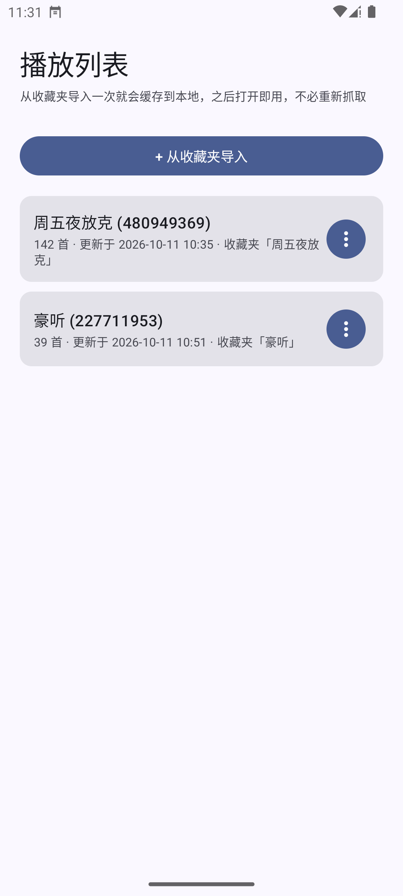
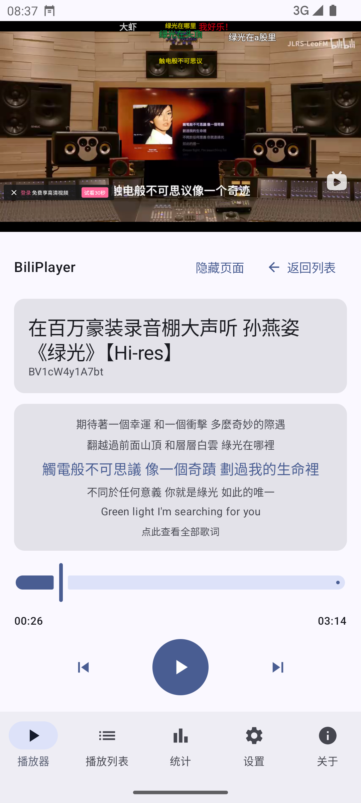
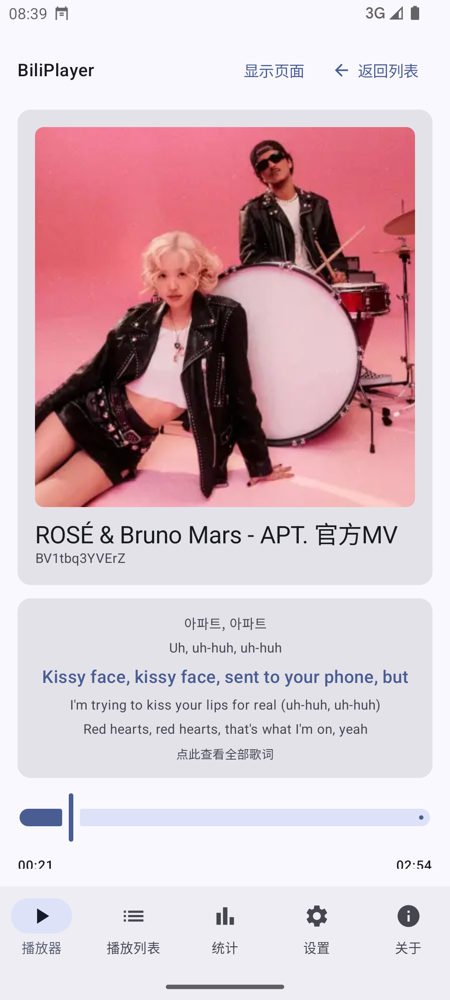
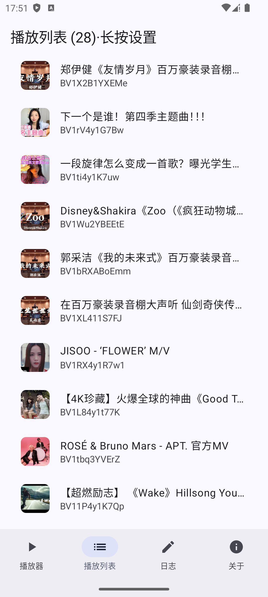
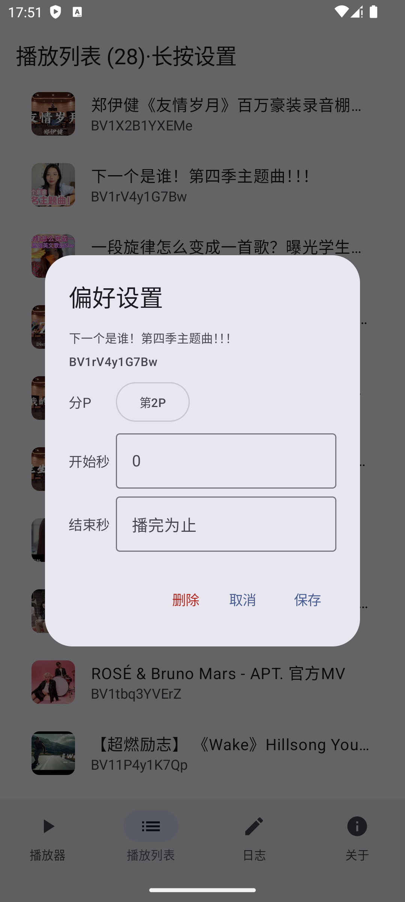
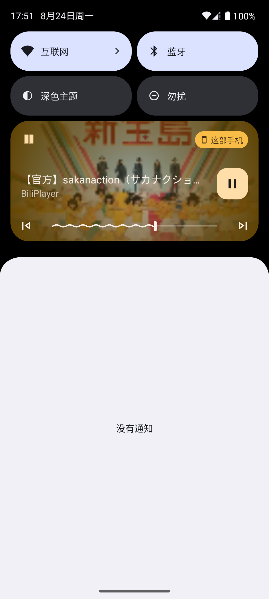
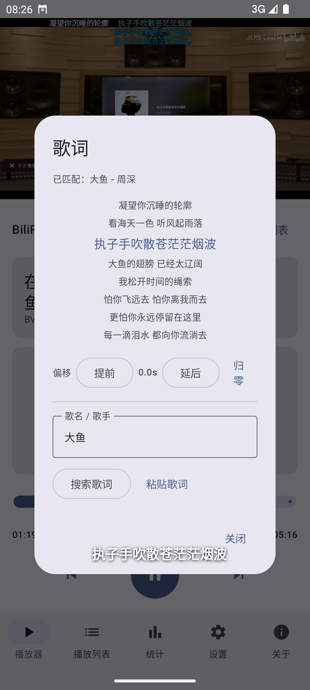
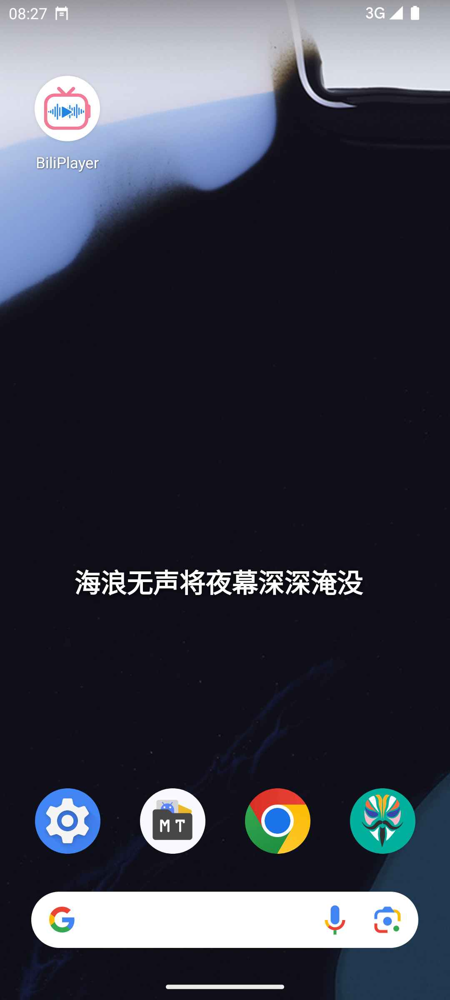
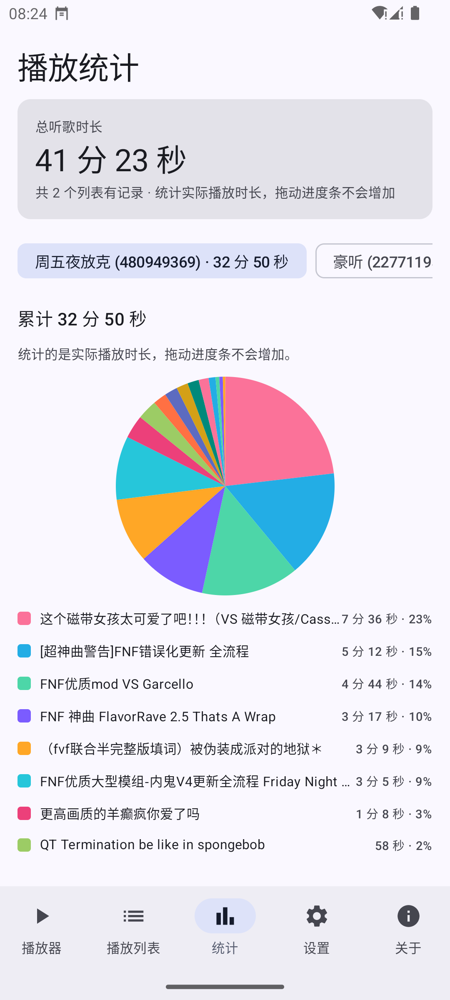
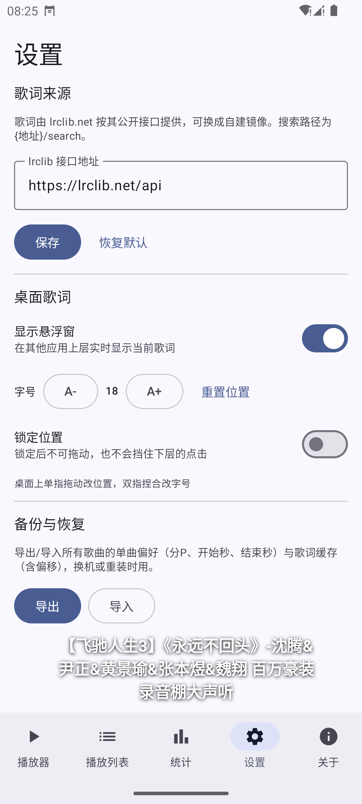

# BiliPlayer（Android）

一个用**无头浏览器**实现的 B 站（Bilibili）音乐播放器。参考桌面端项目 [Gingmzmzx/BiliPlayer](https://github.com/Gingmzmzx/BiliPlayer)（Python + Playwright）的思路，改用 **Android WebView** 作为播放引擎，在手机上实现"读取收藏夹 → 后台纯音频播放 → 系统级媒体控制"，并附带歌词同步、桌面歌词与听歌统计。

> 🌐 **官网 / 下载**：<https://apps.netessx.com/BiliPlayerAndroid>
> 站点上始终是最新版本，可直接下载 APK，也能查看更新内容与公告。

## 📱 截图

<table>
  <tr>
    <td align="center"><b>播放列表库（入口）</b><br></td>
    <td align="center"><b>播放界面（带视频）</b><br></td>
  </tr>
  <tr>
    <td align="center"><b>播放界面（纯封面）</b><br></td>
    <td align="center"><b>播放列表</b><br></td>
  </tr>
  <tr>
    <td align="center"><b>修改播放设置</b><br></td>
    <td align="center"><b>系统媒体控制</b><br></td>
  </tr>
  <tr>
    <td align="center"><b>歌词（待补）</b><br></td>
    <td align="center"><b>桌面歌词（待补）</b><br></td>
  </tr>
  <tr>
    <td align="center"><b>听歌统计（待补）</b><br></td>
    <td align="center"><b>设置（待补）</b><br></td>
  </tr>
</table>

截图系统为Android Studio的avd模拟器，原生Android 14。我也在HyperOS3上进行过测试。

## ✨ 功能

- **播放列表库**：打开应用即是列表库。从收藏夹导入一次就把曲目**缓存到本地**，之后打开即用，不必重新抓取；多个收藏夹各自成库，默认命名「收藏夹名 (uid)」。
- **列表管理**：每个列表可**同步**（重新抓取该收藏夹并覆盖缓存）、**重命名**（重新导入不会冲掉自定义名）、**删除**（连本地缓存一起清掉）。
- **收藏夹导入**：输入 B 站 UID 和收藏夹名称，无头浏览器自动抓取收藏夹视频列表（**纯 DOM 抓取，不调用任何 B 站 API**）。
- **失效视频自动剔除**：播放页出现「视频不见了」即判定视频失效，自动把它从播放列表与本地缓存中删除并播下一首，同时弹 Toast 提示。
- **后台播放**：前台服务 + 离屏 WebView，退到后台 / 锁屏也能继续播放。
- **系统媒体控制**：注册 `MediaSession`，锁屏与蓝牙耳机可控制 播放/暂停、上一曲/下一曲、拖动进度；通知栏带媒体按钮。
- **播放模式**：顺序 / 随机（无重复洗牌队列）/ 单曲循环。
- **单曲偏好**：长按播放列表项可设置 分P、开始秒、结束秒（自动截断切歌），按 `bvid` 持久化。
- **歌词同步**：按视频标题（优先取《》里的歌名）猜歌名，自动到 [lrclib](https://lrclib.net) 检索；搜到多个版本会列出来由你挑选，也可改歌名重搜或直接粘贴自有 LRC。播放器上有歌词预览，弹窗里随播放高亮滚动，**点任意一行直接跳到该句**，并支持逐曲「提前 / 延后」偏移微调。
- **桌面歌词**：悬浮窗覆盖在其他应用之上显示当前歌词；单指拖动改位置、双指捏合改字号，可锁定位置使其不拦截触摸。
- **灵动岛 / 锁屏歌词**：媒体通知的标题位显示当前歌词、副标题显示视频名；前奏还没有歌词时标题回退为视频名。
- **听歌统计**：按列表与曲目统计**实际播放时长**（拖动进度条不计），列表库显示累计时长，播放列表逐首标注已听时长，统计页用饼图展示占比。
- **设置页**：自定义 lrclib 接口地址（可接自建镜像）、桌面歌词字号 / 锁定 / 位置复位、单曲偏好与歌词的**导入导出**（JSON，换机迁移用）。
- **视频画面 / 看 MV**：显示 WebView 即可观看当前歌曲的视频画面（MV），边听边看；视频加载后自动网页全屏并隐藏控制条（导入页可勾选关闭自动全屏，关闭则默认显示封面）。
- **配置持久化**：UID、收藏夹名、音量、播放模式、自动全屏、单曲偏好、歌词与偏移、桌面歌词设置均保存在本地。
- **WebView 显示/隐藏**：可随时切换是否显示视频画面。
- **应用内更新 / 公告**：启动时静默检查最新版本与公告（公告内容支持简单 HTML 排版与链接），关于页可手动检查更新，下载后直接唤起系统安装。
- **日志 / 关于**：运行日志收在关于页（「运行日志」按钮），底部导航为 播放器 / 播放列表 / 统计 / 设置 / 关于。

## 🧠 原理

与桌面端一致的核心思路：**用浏览器加载视频页，播放 `<video>` 的音频**。
WebView 同时也是视频画面显示层——显示 WebView 时，用户可以看到当前歌曲的 MV/视频画面，边听边看。

| 模块 | 说明 |
|---|---|
| `HeadlessBrowser` | 离屏 WebView（不挂窗口，`KeepVisibleWebView` 保持 Chromium 认为窗口可见），桌面 UA |
| `BiliUser` | 打开 `space.bilibili.com/{uid}/favlist`，优先提取收藏夹 `fid` 直接导航，失败则真实触摸点击侧栏项，抓取 `.bili-video-card` |
| `BiliMusicPlayer` | 加载 `www.bilibili.com/video/{bvid}`，等待 `<video>`，注入 stealth + anti_pause，自动播放并轮询控制 |
| `PlayerController` | 单例状态持有者，向 UI 暴露 `StateFlow` |
| `PlayerService` | 前台服务（mediaPlayback）+ `MediaSession`，后台播放与系统媒体控制 |
| `PlaylistStore` | 播放列表库，曲目缓存到 `filesDir/playlists.json` |
| `Lyrics` / `LyricsStore` / `LrcLib` | LRC 解析、歌词缓存（`filesDir/lyrics.json`）、lrclib 检索（UA 每台设备不同但不含设备信息） |
| `LyricsOverlay` | 桌面歌词悬浮窗（`TYPE_APPLICATION_OVERLAY`，可拖动 / 缩放 / 锁定） |
| `PlaybackStats` | 听歌时长统计（`filesDir/stats.json`，按 列表 → 曲目 累计秒数） |
| `Backup` | 单曲偏好与歌词的 JSON 导入导出（走系统文件选择器） |
| `MainActivity` | Compose 界面：列表库 / 导入表单 + 底部导航（播放器 / 播放列表 / 统计 / 设置 / 关于） |

**为什么用"真实触摸"而非 JS 点击？** `evaluateJavascript` 里的 `element.click()` 是**非可信事件**（`isTrusted=false`），B 站会忽略；而通过 `dispatchTouchEvent` 派发真实触摸，Chromium 视为可信用户手势，才能触发全屏、点击收藏夹等交互。

**为什么 WebView 要挂到窗口？** B 站页面依赖渲染（`requestAnimationFrame` / `IntersectionObserver` / 懒加载）才加载侧栏和卡片，完全离屏不渲染会导致内容抓取不到。

## 🔨 构建

环境要求：Android Studio / Gradle，JDK 17+，Android SDK Platform 37。

```bash
./gradlew assembleDebug
```

产物：`app/build/outputs/apk/debug/app-debug.apk`

`versionCode` 由构建脚本自动生成，格式为 **年 + 月 + 日 + 当日构建数**（`YYMMDDNN`），例如 `26092701` 表示 26 年 9 月 27 日的第 1 次构建。日期与计数保存在根目录 `build-stamp.properties`（已加入 `.gitignore`），跨天自动归零重新计数。

不想自己编译，可直接从官网下载：<https://apps.netessx.com/BiliPlayerAndroid>

## 📱 使用

1. 安装并打开 App，进入**播放列表库**。
2. 点「+ 从收藏夹导入」，输入 **UID**（B 站空间地址里的数字）与 **收藏夹名称**（需为公开收藏夹），按需勾选"自动全屏并隐藏控制条"（可选：先点「登录 B 站」以访问私密收藏夹）。
3. 点「抓取并播放」→ 无头浏览器抓取收藏夹（顶部可看到抓取过程；自动点击失败时可按提示手动点选）。抓完会缓存到本地。
4. 抓取成功进入播放器：自动播放第一首（随机模式随机起点），后台可继续播放。
5. 点「返回列表」回到播放列表库。之后直接点库里任意一条即可播放，**不用重新抓取**。
6. 列表右上角 `⋮`：**同步** / **重命名** / **删除**。
7. 底部导航切换：播放器 / 播放列表 / 统计 / 设置 / 关于。
8. **播放列表**：点 = 播放；**长按** = 设置该曲的 分P / 开始秒 / 结束秒，或删除。
9. **歌词**：点播放器上的歌词卡片打开歌词弹窗。可改歌名重搜、从候选列表选版本、粘贴自有 LRC、按「提前 / 延后」微调偏移；点歌词任意一行直接跳到该句。首次使用前会弹出歌词来源声明，同意后才启用。
10. **桌面歌词**：设置页打开「显示悬浮窗」（需授予「显示在其他应用上层」权限），之后可单指拖动、双指缩放、锁定位置。
11. **统计 / 备份**：统计页看总时长与饼图；设置页可导出/导入单曲偏好与歌词。

## ⚙️ 常见问题

- **首次抓取失败**：WebView 冷启动较慢，已通过启动预热缓解；仍失败可重试。
- **自动全屏导致误触**：主界面 WebView 已加透明触摸拦截层（抓取阶段不屏蔽，便于手动介入）。
- **后台播放被系统杀掉**：请在系统设置中允许本应用后台运行 / 加入省电白名单。
- **收藏夹里的视频失效了**：不用管。应用会识别「视频不见了」页面，自动把该曲从播放列表与本地缓存中删掉并跳下一首，同时弹 Toast 提示。
- **歌词是从哪来的？**：来自第三方歌词库 [lrclib.net](https://lrclib.net) 的公开接口。本应用不生产、不审核歌词，首次启动会弹出声明，**不同意将无法使用本应用**。可在设置页换成自建接口地址，或直接粘贴自有 LRC。
- **歌词和音频对不上**：歌词跑在前面点「延后」，落在后面点「提前」，按曲目记住，不设上限。纯文本歌词没有时间轴，不会滚动。
- **桌面歌词不显示**：需要「显示在其他应用上层」权限——设置页 → 桌面歌词 → 去授予悬浮窗权限，授权后重新打开开关。

## 🔗 链接

- 官网 / 下载：<https://apps.netessx.com/BiliPlayerAndroid>
- 上游桌面版项目：[Gingmzmzx/BiliPlayer](https://github.com/Gingmzmzx/BiliPlayer)

## 📄 致谢

- 思路参考：[Gingmzmzx/BiliPlayer](https://github.com/Gingmzmzx/BiliPlayer)（Python + Playwright 桌面版）

## 📃 License

本项目采用 [Apache License 2.0](LICENSE)，同时禁止商用。
